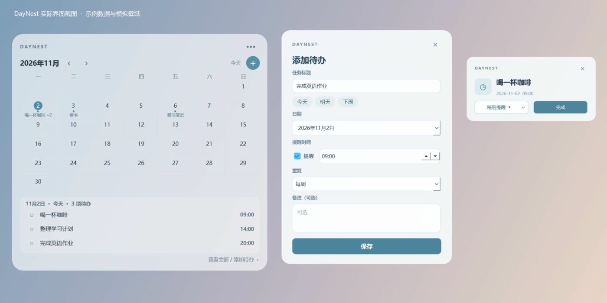

<div align="center">

# DayNest

**让日程，轻轻停在桌面。**

一款为 Windows 打造的桌面日历与待办应用。
用舒适的透明组件，看见今天，也记下接下来要做的事。

Windows 11 · Python · PySide6 · SQLite

[功能介绍](#功能介绍) · [开始使用](#开始使用) · [常见问题](#常见问题) · [参与贡献](#参与贡献)

</div>



> 图中是程序实际界面的拼合截图，使用示例数据和模拟壁纸。DayNest 正处于早期开发阶段，欢迎体验和反馈。

## 为什么做 DayNest？

有时我们不需要打开一个复杂的应用，只想抬眼看看今天的安排，或迅速记下一件事。DayNest 把日历、待办和便签放进一个轻巧的 Windows 桌面组件：平时安静地待在桌面上，需要时再展开操作。

项目由 [@jiajunli1007-lab](https://github.com/jiajunli1007-lab) 发起和维护，使用 Python 与 PySide6 开发。数据保存在本机，不需要注册 DayNest 账号。

## 功能介绍

### 桌面组件

- **四种尺寸**：小、中、大和日历，适应不同的桌面空间。
- **自定义外观**：调节背景透明度，切换浅色或深色；背景可以完全透明，文字和控件仍然可见。
- **灵活放置**：拖动顶部移动组件，位置和外观设置保存在本机。
- **窗口层级**：可选择普通、靠后或置顶模式；托盘可用时可以隐藏和恢复组件。

### 日历和待办

- 在日历日期下查看事项摘要，点击日期查看当天待办。
- 点击日历中的 `＋` 添加事项；支持编辑、删除、完成和按日期筛选。
- 为事项设置日期、提醒时间和备注，可选择每天、每周或每月重复。
- 重复事项支持修改单次或本次及以后的安排。月末事项在较短月份安排在该月最后一天。
- 提醒卡片支持直接完成，或选择 10 分钟、1 小时后再次提醒。

### 便签与数据

- 按日期记录便签，输入停止后自动保存，也可以手动保存。
- 待办、便签和设置使用本地 SQLite 数据库保存。
- 在管理窗口的“备份与恢复”菜单中备份数据；恢复前会自动创建一份安全备份。

## 开始使用

### Windows 应用包

**Windows 可执行版本尚未公开发布。** 应用包的第三方许可证和真实桌面兼容性仍在核验。准备完成后，计划通过 GitHub Releases 提供下载。

### 从源码运行

目前开发和测试环境为 **Windows 11、Python 3.15、PySide6 6.12**。需要 Python 3.15 和 Git；也可以通过 GitHub 的 `Code → Download ZIP` 下载源码并解压。

1. 在项目根目录打开 PowerShell，创建独立虚拟环境：

   ```powershell
   py -3.15 -m venv .venv-diagnostic
   ```

2. 安装项目依赖：

   ```powershell
   .\.venv-diagnostic\Scripts\python.exe -m pip install -r requirements.txt
   ```

3. 启动 DayNest：

   ```powershell
   .\.venv-diagnostic\Scripts\python.exe -m daynest
   ```

如果已创建 `.venv-diagnostic`，请直接使用现有环境。不同 Windows 设备上的安装和显示行为仍需要更多验证。

### 第一次打开

1. 拖动组件顶部可移动位置；点击右上角 `•••` 打开设置菜单。
2. 选择 **组件尺寸 → 日历**，查看带待办摘要的月历。
3. 点击日期，再点击日历中的 `＋` 添加待办；点击事项文字可编辑，点击圆圈可完成。
4. 双击组件，或在菜单中选择“打开日历和待办”，可以打开管理窗口。
5. 托盘可用时，使用托盘图标恢复组件；退出可通过组件菜单完成。

## 常见问题

**关闭程序后还能收到提醒吗？**

不能。提醒按电脑本地时间在 DayNest 运行期间约每 15 秒检查一次。关闭、关机或睡眠期间不会弹出；重新运行时会检查已有的未完成过期提醒。长时间未运行时，重复事项只自动补建最近 30 天尚未生成的实例。本版本不自动添加开机启动。

**它是真正的 Windows 壁纸层组件吗？**

目前不是。组件使用 Qt 绘制半透明背景；“桌面靠后”只是窗口层级设置。真正的桌面壁纸层仍是独立实验，尚未完成真实桌面验证；也未实现真实背景模糊。

**数据保存在哪里？**

默认使用当前用户的本地应用数据目录，Windows 上通常位于 `%LOCALAPPDATA%\DayNest`。可以在管理窗口备份和恢复；也可以通过启动参数 `--data-dir` 指定数据目录。恢复会替换当前数据，但会先创建安全备份。

**快捷键和托盘一定可用吗？**

程序会尝试注册 `Ctrl+Alt+N` 打开管理窗口；如果注册失败，可查看组件菜单按钮的提示。托盘、快捷键、Win+D、多显示器和缩放的实际表现仍需要更多真实桌面测试。

## 开发与测试

```powershell
.\.venv-diagnostic\Scripts\python.exe -B -m unittest discover -s tests -v
```

自动化测试使用 Qt offscreen，不能代替真实 Windows 桌面验收。技术调研、桌面层实验和测试记录分别见 [调研记录](docs/RESEARCH.md)、[壁纸层实验](docs/WALLPAPER_EXPERIMENT.md) 和 [测试说明](docs/TESTING.md)。

如需本地构建测试包，可在专用虚拟环境安装 `requirements-build.txt` 后运行：

```powershell
.\.venv-diagnostic\Scripts\python.exe -m tools.build_windows
```

构建结果仅供测试。公开分发前需分别核验 Qt、PySide6、Python 和其他打包组件的许可证及对应义务。

## 接下来的方向

- 在真实 Windows 桌面上完善托盘、快捷键、提醒和多显示器体验。
- 继续探索真正的桌面壁纸层，同时保留可用的普通窗口方案。
- 打磨更多个性化选项与日常记录体验。
- 完成发布所需的许可证核验和 Windows 应用包验收。

以上为计划，具体功能以当前代码和发布说明为准。

## 参与贡献

欢迎通过 GitHub Issues 提出问题、分享使用体验或建议；也欢迎提交改进代码。提交前请尽量说明运行环境、复现步骤和期望结果，不要包含个人数据或密钥。

## 许可证

DayNest 项目代码采用 [MIT License](LICENSE)。PySide6、Qt 和其他依赖使用各自的许可证；重新分发依赖或打包程序时，还需遵守其对应条款。更多背景见 [技术调研与复用记录](docs/RESEARCH.md)。
